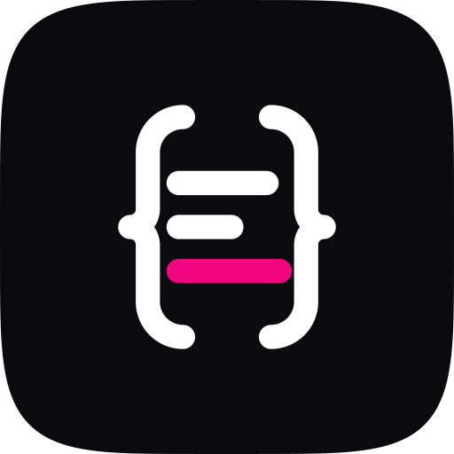

# ndb brand

<p>
  
</p>

This folder holds the ndb visual identity: the mark, the wordmark, the lockups, the app icons, the colors, and the CSS tokens. Use these files. Do not draw the mark again.

## The mark: Braces and lines

<p>
  
</p>

A pair of braces holds three lines. Each line is one record of an NDJSON file, and each line has its own length. The last line is the committed line. It is the only part with the accent color.

### Construction

The mark is built on a 64 unit grid. `tools/build.py` calculates all values.

| Rule | Value |
|---|---|
| Braces | One path each. The right brace mirrors the left brace around the center of the grid. |
| Spine | 14 units from the edge. 50 units tall, from y 7 to y 57. |
| Hook | Quarter circle with a radius of 8 units at the top and at the bottom of each brace. |
| Tip | Two quarter circles with a radius of 4 units. They meet on the middle line, y 32. |
| Stroke | Braces 5.5 units. Lines 5.5 units. All ends are round. |
| Lines | They start at x 21 and sit at y 22, 32, and 42. Lengths are 20, 12, and 23 units. |
| Accent | Only the last line, the third one. |

### Small drawing

At 24 px and below, use the small drawing (`mark-small-*`, `favicon.svg`). It has heavier strokes, smaller hooks, and shorter lines. Do not use the primary mark at these sizes, because its strokes get thinner than 1 pixel.

| Rule | Primary | Small |
|---|---|---|
| Spine height | 50 | 48 |
| Hook radius | 8 | 6 |
| Tip radius | 4 | 3.5 |
| Brace stroke | 5.5 | 7 |
| Line stroke | 5.5 | 7 |
| Line lengths | 20, 12, 23 | 17, 10, 21 |

## Wordmark

The wordmark is `ndb` in lowercase. It has no font. `tools/build.py` draws the three letters from geometry, so the files do not need any font.

| Rule | Value |
|---|---|
| x-height | 100 units. All other values use this unit. |
| Stem | 19 units. All strokes have this weight. |
| Bowls | Circles with a diameter of 100 units. They are `d` and `b`. |
| Arch | A half circle with a diameter of 100 units on two stems. It is `n`. |
| Ascender | 145 units. It is the height of `d` and `b`. |
| Gaps | 12 units between `n` and `d`. 18 units between `d` and `b`. The larger gap is between two straight stems. |

## Lockups

| File | Use |
|---|---|
| `lockup-on-dark`, `lockup-on-light` | Default. Headers, websites, documents. |
| `lockup-stacked-on-dark`, `lockup-stacked-on-light` | Square spaces, title slides. |

In the horizontal lockup, the mark is as tall as the ascender of the wordmark, and its bottom is on the baseline. The gap between the mark and the word is 0.5 x-heights.

In the stacked lockup, the mark is 2.4 x-heights tall, with 0.8 x-heights of space above the word.

### Clear space and minimum size

- Keep clear space around a lockup equal to the x-height of the wordmark. The lockup files are cut on the ink, so add this space when you place them.
- The 64 unit mark files have padding inside the grid. You can place them edge to edge.
- Minimum width of a horizontal lockup: 96 px on screen, 25 mm in print.
- Minimum size of the mark: 16 px, with the small drawing.

## App icons

| File | Use |
|---|---|
| `app-icon-ink` | Default app icon. Dark tile, white braces. |
| `app-icon-paper` | Light pages. White tile with a thin edge. |
| `app-icon-accent` | Brand surfaces and marketing. The last line is ink. |
| `app-icon-square` | iOS, Android, and PWA. These platforms cut their own mask. The mark stays in the maskable safe zone. |

The squircle shape is a superellipse with power 5. It is not a rounded rectangle. Tiles are flat. They have no gradient.

## Color

The look is light and clean: white paper, near-black ink, neutral gray lines, and one hot-pink accent. The primary button is black.

| Token | Light | Dark | Use |
|---|---|---|---|
| `ink` | `#0B0B0F` | `#F4F4F6` | Text, the mark, and primary buttons. |
| `paper` | `#FFFFFF` | `#0E0E11` | Page background. |
| `line` | `#E5E5E5` | `#26262C` | Borders and dividers. |
| `muted` | `#6B6B76` | `#9A9AA5` | Secondary text. |
| `accent` | `#F0047F` | `#F0047F` | The committed line, links, focus, and highlights. |
| `accent-soft` | `#FDE6F1` | `#2A0A1B` | Accent background: callouts, selected rows, inline code. |

Rules:

- The accent is the same in light and dark mode.
- Use the accent for small things. Text on `paper` in accent has a contrast of 4.4:1, so use it only for large text, links with an underline, and graphics.
- On an accent background, use white (`#FFFFFF`) text.
- Primary buttons are `ink` with `paper` text, in both modes. Secondary buttons have a `line` border.

`tokens.css` has these values as CSS custom properties (`--ndb-ink`, `--ndb-paper`, `--ndb-line`, `--ndb-muted`, `--ndb-accent`, `--ndb-accent-soft`, plus button and font tokens). It follows `prefers-color-scheme: dark`. Set `data-theme="light"` or `data-theme="dark"` on `<html>` to force a theme.

## Do not

- Do not change the curves, the stroke weights, or the line lengths.
- Do not color more than one line with the accent. Do not color the braces.
- Do not rotate, stretch, or outline the mark.
- Do not add shadows, glows, or gradients.
- Do not set the wordmark in a font. Use the files.
- Do not put the mark on a busy photo or pattern.

## Files

```
svg/   Source files. Use these when the platform accepts SVG.
png/   Rendered files for platforms that need PNG.
favicon.ico   16, 32, and 48 px, on an ink tile.
tokens.css   Color and type tokens for the docs site.
index.html   Gallery of all PNG files.
tools/   Scripts that build the files.
```

| Need | File |
|---|---|
| Website favicon | `svg/favicon.svg` (follows the light or dark browser theme), and `favicon.ico` as a fallback |
| Apple touch icon | `png/apple-touch-icon.png` (180 px) |
| PWA manifest | `png/icon-192.png`, `png/icon-512.png` (maskable) |
| GitHub social preview | `png/social-preview.png` (1280 by 640) |
| GitHub and package avatar | `png/app-icon-ink-512.png` |
| Docs top bar | `svg/lockup-on-light.svg` and `svg/lockup-on-dark.svg`, or `svg/mark-small-on-light.svg` at 24 px |

## Build

```bash
python3 brand/tools/build.py
brand/tools/render.sh
```

`build.py` uses only the Python standard library. `render.sh` needs `rsvg-convert` (librsvg) and `magick` (ImageMagick), and it also writes `index.html`.

The tagline outline on the social preview is in `tools/wordmark.json`. To change the tagline, run `tools/outline_wordmark.py` with the Inter font. The script tells you how to install its two packages. Inter is under the SIL Open Font License.
