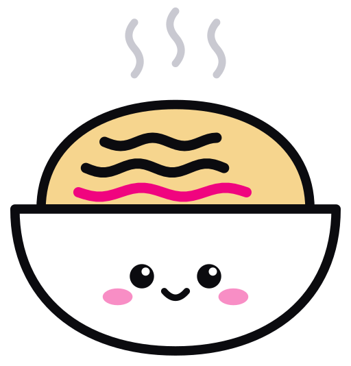

# ndb brand

<p>
  
</p>

This folder holds the ndb visual identity: the mascot, the wordmark, the lockups, the app icons, the colors, and the CSS tokens. Use these files. Do not draw the mascot again.

## The mascot: the ramen bowl

<p>
  
</p>

The mark is a mascot, and the mascot is the logo. It is a ramen bowl with a face. The idea is "one line, one noodle": the noodles on top are the lines of an NDJSON file, each with its own length. The last noodle is the committed line, and it is the only noodle with the accent color. The noodles are gently wavy, so they read as noodles and still as lines. Steam comes up from the bowl, so the data is always warm.

### Construction

The mascot is built on a 200 unit grid. `tools/build.py` calculates all values.

| Part | Rule |
|---|---|
| Outline | 5 units, `#0B0B0F`, round joins and round ends, on every shape. |
| Bowl | A flat rim at y 112, from x 14 to x 186. Below it, a half ellipse down to y 188. White fill. |
| Noodles | A dome from x 28 to x 172, from the rim up to y 56. Fill `#F6D58E`. |
| Lines | Three wavy noodle lines (a soft sine, 1.75 to 2 waves, amplitude about 2.3, round ends) at y 76, 90, 103. Lengths 60, 74, 90, staggered. Stroke 5.5. The first two are ink, the last one is accent. |
| Steam | Three wavy strokes of 4 units in gray, from y 6 to y 40. |
| Face | Dot eyes (radius 6.5) with a white highlight, two cheeks in accent at 45% opacity, a small smile of 3.5 units. Centered at (100, 148). |

### Small drawing

At 32 px and below, use the small drawing (`mark-small-*`). It has no steam, two heavy noodles instead of three, an outline of 7 units, and a face 30% bigger.

At 16 px and in favicons (`favicon.svg`, `favicon.ico`, `favicon-*.png`), use the tiny drawing: only the bowl with the face and one magenta noodle that peeks over the rim. The outline is 8 units and the face is 45% bigger.

### Dark surfaces

The mascot keeps its white bowl and its ink outline on dark surfaces. The on-dark variants (`mark-on-dark`, `mark-small-on-dark`, `lockup-*-on-dark`, the ink app icon, the dark favicon tile) add a thin white halo around the bowl and the noodle dome, so the edge does not vanish into the dark. The steam gets a lighter gray. Do not turn the fills dark. 

## Extras: the cast

ndb uses only the ramen bowl. The onigiri, the caterpillar and the scroll live in `extras/cast/` (SVG and 512 px PNG). They share the bowl's drawing language and are kept for other projects. Do not use them in ndb.

## Wordmark

The wordmark is `ndb` in lowercase, bold, with rounded terminals like the mascot. It is our own drawing, not a font: `tools/build.py` builds the three letters as filled paths from circles, arcs and capsules, so no file needs a font.

| Rule | Value |
|---|---|
| x-height | 100 units. All other values use this unit. |
| Stem | 35 units (0.35 x-heights), a heavy weight. All vertical stems have this weight in all three letters. Horizontal parts (the top of the arch and the bowls) are 30 units, a little lighter, so the counters stay open. |
| Width | Each letter is 116 units wide, wider than tall, so the heavy weight does not clog. |
| Ends | Stems are capsules: a full round end, radius 17.5. The feet of `n` are round too. |
| `n` | A left stem to the x-height, an arch (half ellipse, outer radii 58 by 50, counter radii 23 by 20), and a right stem with a round foot. |
| `d` and `b` | An elliptical ring (outer radii 58 by 52, counter radii 23 by 22) and a stem to the ascender at 145 units. The stem is tangent to the ring and shares its bottom. |
| Overshoot | The rings are 2 units taller than the x-height, so they look as tall as the straight stems. They reach 2 units under the baseline. |
| Counters | About 46 units wide. Do not make the weight any heavier: the counters would close at small sizes. |
| Gaps | 9 units between `n` and `d` (stem to round). 14 units between `d` and `b` (stem to stem). The gaps are optical: a round side needs less room. |

## Lockups

| File | Use |
|---|---|
| `lockup-on-dark`, `lockup-on-light` | Default. Headers, websites, documents. |
| `lockup-stacked-on-dark`, `lockup-stacked-on-light` | Square spaces, title slides. |

In the horizontal lockup, the x-height of the wordmark is 0.47 of the mascot height. The wordmark sits on the visual baseline of the bowl (the bottom of the bowl, with the 2 unit overshoot of the rings just under it). The gap between the mascot and the word is 0.2 of the mascot height. The canvas has a small pad on the right, so the `b` is never cut.

In the stacked lockup, the mascot is 3 x-heights tall, with 0.5 x-heights of space above the word.

### Clear space and minimum size

- Keep clear space around a lockup equal to the x-height of the wordmark. The lockup files are cut on the ink, so add this space when you place them.
- The mascot files are cut on the drawing. Add the clear space when you place them.
- Minimum width of a horizontal lockup: 96 px on screen, 25 mm in print.
- Minimum size of the mascot: 16 px, with the small drawing.

## App icons

| File | Use |
|---|---|
| `app-icon-ink` | Default app icon. Dark tile, the mascot with its white bowl. |
| `app-icon-paper` | Light pages. White tile with a thin edge. |
| `app-icon-accent` | Brand surfaces and marketing. The last noodle is ink. |
| `app-icon-square` | iOS, Android, and PWA. These platforms cut their own mask. The mark stays in the maskable safe zone. |

The squircle shape is a superellipse with power 5. It is not a rounded rectangle. Tiles are flat. They have no gradient.

## Color

The look is light and clean: white paper, near-black ink, neutral gray lines, and one hot-pink accent. The primary button is black.

| Token | Light | Dark | Use |
|---|---|---|---|
| `ink` | `#0B0B0F` | `#F4F4F6` | Text, the outline, and primary buttons. |
| `paper` | `#FFFFFF` | `#0E0E11` | Page background. |
| `line` | `#E5E5E5` | `#26262C` | Borders and dividers. |
| `muted` | `#6B6B76` | `#9A9AA5` | Secondary text. |
| `accent` | `#F0047F` | `#F0047F` | The committed noodle, links, focus, and highlights. |
| `accent-soft` | `#FDE6F1` | `#2A0A1B` | Accent background: callouts, selected rows, inline code. |

Rules:

- The accent is the same in light and dark mode.
- Use the accent for small things. Text on `paper` in accent has a contrast of 4.4:1, so use it only for large text, links with an underline, and graphics.
- On an accent background, use white (`#FFFFFF`) text.
- Primary buttons are `ink` with `paper` text, in both modes. Secondary buttons have a `line` border.

`tokens.css` has these values as CSS custom properties (`--ndb-ink`, `--ndb-paper`, `--ndb-line`, `--ndb-muted`, `--ndb-accent`, `--ndb-accent-soft`, plus button and font tokens). It follows `prefers-color-scheme: dark`. Set `data-theme="light"` or `data-theme="dark"` on `<html>` to force a theme.

## Do not

- Do not change the curves, the stroke weights, or the noodle lengths.
- Do not color more than one noodle with the accent. Do not color the bowl.
- Do not change the face, and do not draw the mascot sad or angry. The onigiri is for that.
- Do not use the cast in ndb.
- Do not rotate, stretch, or re-outline the mascot.
- Do not add shadows, glows, or gradients.
- Do not set the wordmark in a font. Use the files.
- Do not put the mark on a busy photo or pattern.

## Files

```
svg/   Source files. Use these when the platform accepts SVG.
png/   Rendered files for platforms that need PNG.
favicon.ico   16, 32, and 48 px, on an ink tile.
tokens.css   Color and type tokens for the docs site.
index.html   Gallery of all PNG files.
tools/   Scripts that build the files.
```

| Need | File |
|---|---|
| Website favicon | `svg/favicon.svg` (the small drawing), and `favicon.ico` as a fallback |
| Apple touch icon | `png/apple-touch-icon.png` (180 px) |
| PWA manifest | `png/icon-192.png`, `png/icon-512.png` (maskable) |
| GitHub social preview | `png/social-preview.png` (1280 by 640) |
| GitHub and package avatar | `png/app-icon-ink-512.png` |
| Docs top bar | `svg/lockup-on-light.svg` and `svg/lockup-on-dark.svg` |

## Build

```bash
python3 brand/tools/build.py
brand/tools/render.sh
```

`build.py` uses only the Python standard library. `render.sh` needs `rsvg-convert` (librsvg) and `magick` (ImageMagick), and it also writes `index.html`.

The tagline outline on the social preview is in `tools/wordmark.json`. To change the tagline, run `tools/outline_wordmark.py` with the Inter font. The script tells you how to install its two packages. Inter is under the SIL Open Font License.
