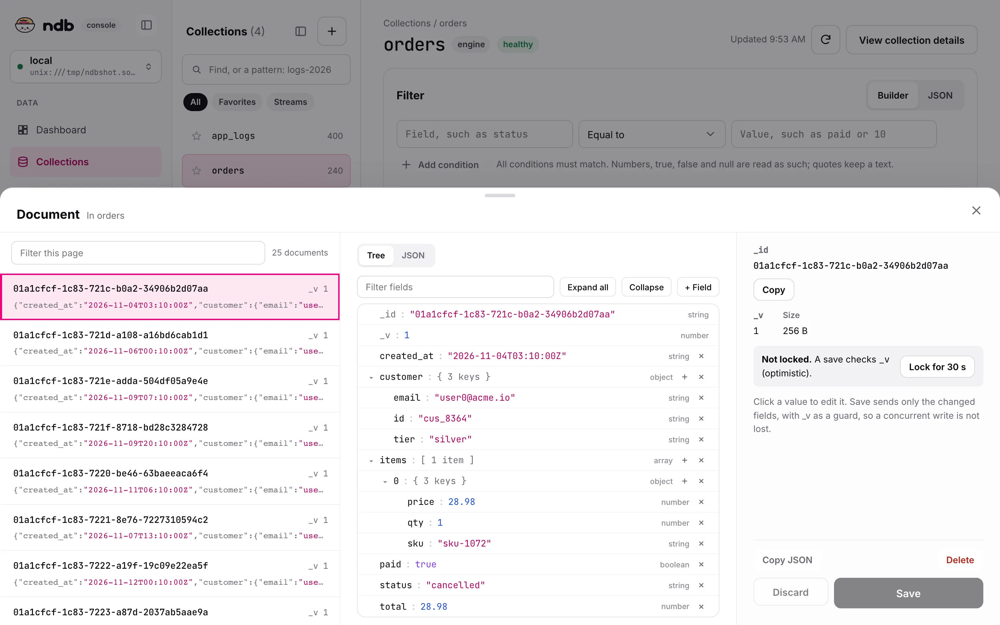
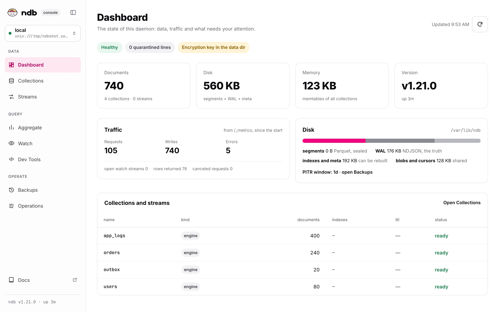
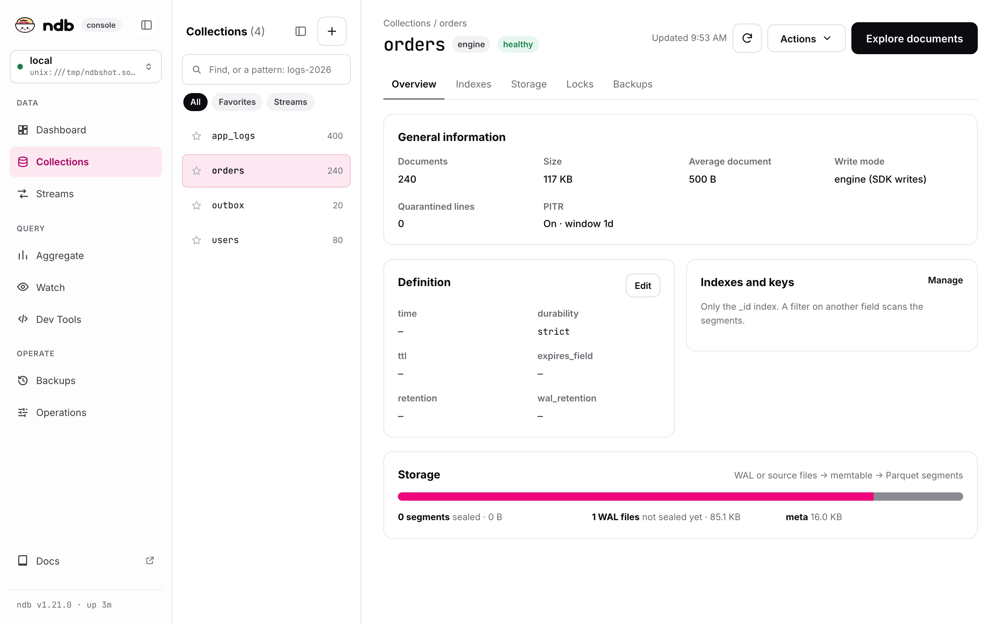
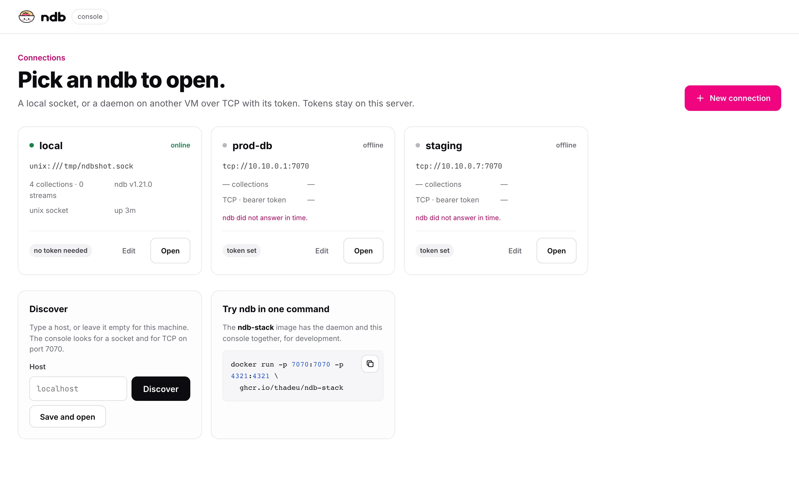
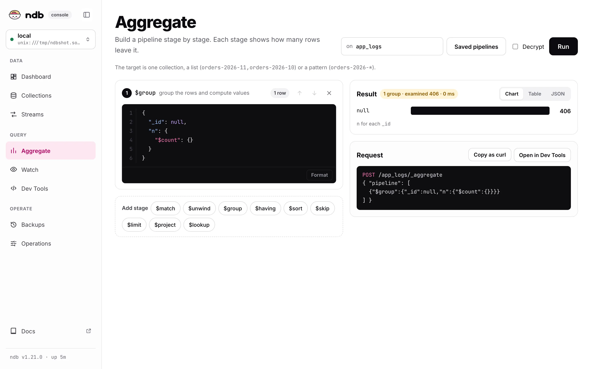
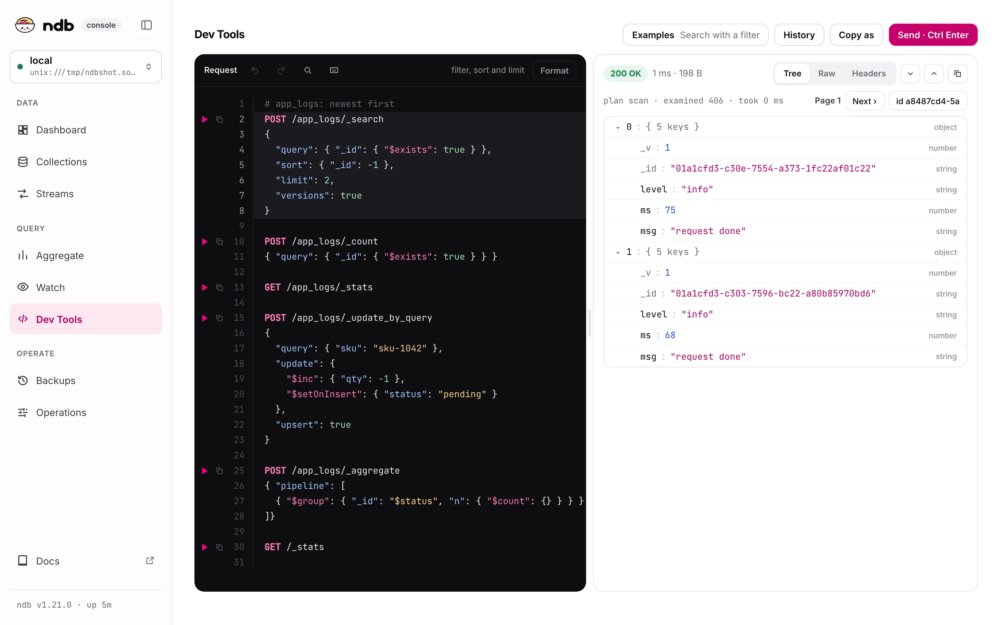
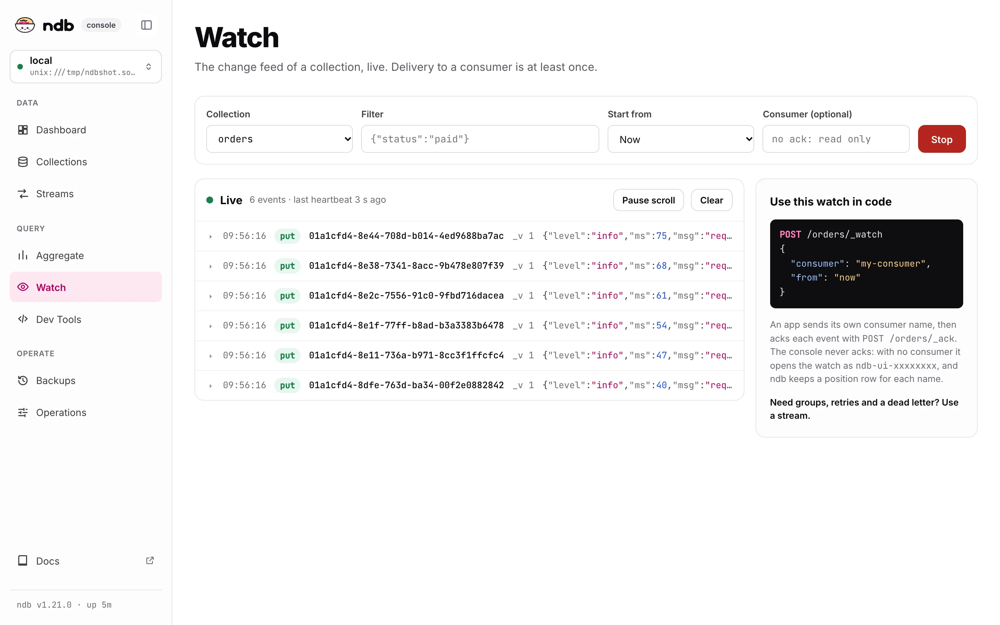
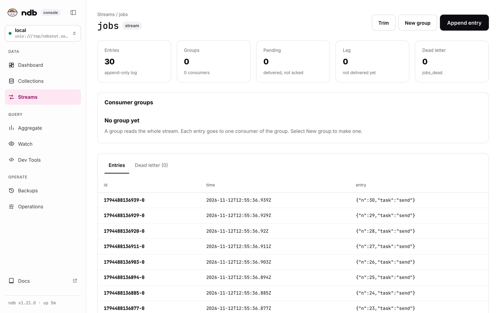
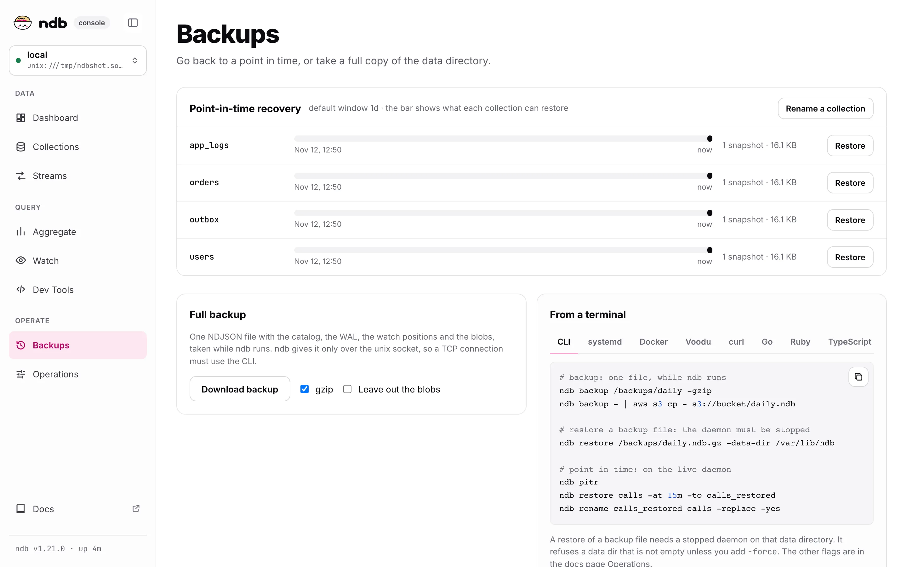
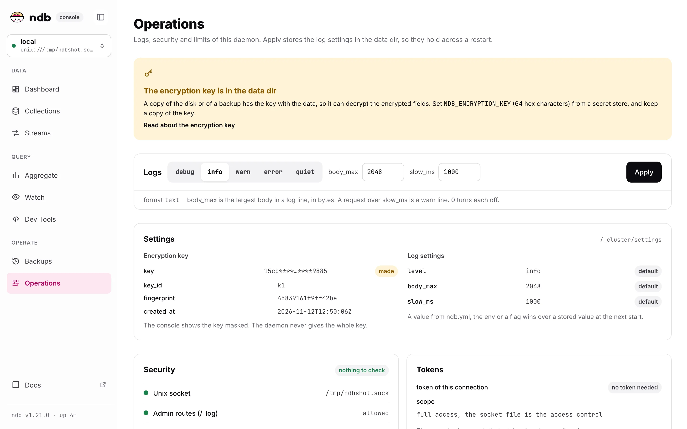

# ndb UI

`ndb-ui` is the web console for ndb. Open a local socket or a remote daemon, see the collections, edit documents as a JSON tree, send raw requests, tail changes live, read streams, and take backups. Click a screenshot to see it at full size.

<div class="ui-gallery">
  <figure class="ui-shot wide"><figcaption>Browser: filter, page, and edit a document as a tree</figcaption></figure>
  <figure class="ui-shot wide"><figcaption>Dashboard</figcaption></figure>
  <figure class="ui-shot"><figcaption>Collections</figcaption></figure>
  <figure class="ui-shot"><figcaption>Connections</figcaption></figure>
  <figure class="ui-shot"><figcaption>Aggregate</figcaption></figure>
  <figure class="ui-shot"><figcaption>Dev Tools</figcaption></figure>
  <figure class="ui-shot"><figcaption>Watch</figcaption></figure>
  <figure class="ui-shot"><figcaption>Streams</figcaption></figure>
  <figure class="ui-shot"><figcaption>Backups</figcaption></figure>
  <figure class="ui-shot"><figcaption>Operations</figcaption></figure>
</div>

## Start

::: code-group

```bash [Binary]
curl -fsSL https://ndb.clowk.in/install.sh | bash -s -- --ui
ndb-ui                         # http://127.0.0.1:4321
```

```bash [Docker]
docker run -p 127.0.0.1:4321:4321 \
  -e NDB_URL=tcp://10.10.0.1:7070 -e NDB_TOKEN=... \
  ghcr.io/thadeu/ndb-ui
```

:::

Then open http://127.0.0.1:4321, click **New connection**, and press **Discover**. See [Install](ui/install.md) and [Docker](ui/docker.md) for every option, and the [Guide](ui/guide.md) for each screen.

## Self-hosted

The console is **self-hosted only**. You run it on your machine or next to your daemons, and it talks to them directly. There is no account, no login, and nothing leaves your network. It is free, in the same repository and under the same license as ndb.

A **hosted console** (one place for all your daemons, with sign-in and teams) is planned for later. It does not exist yet, and the self-hosted console stays: the hosted version will be built on top of it, not instead of it.

| | Self-hosted (now) | Hosted (planned) |
|---|---|---|
| Where it runs | your machine, a VM, or a container | managed for you |
| Login | none; keep it on localhost or behind your own proxy | accounts and teams |
| Daemons | any socket or TCP address it can reach | daemons that you register |
| Tokens | `~/.config/ndb/console.json` on the console host | stored by the service |

## Security

- **Localhost only, no login.** Anyone who can open the page can read and write every collection of the connected daemons. Do not expose the console on a public network. To share it, put it behind a proxy that does the login, and set `X-Forwarded-Prefix` if it is not at the root.
- **The browser never gets a token.** Pages are drawn on the server, and every action is a POST route on the console, which adds the token. The pages only show "token set".
- **Tokens are kept in `~/.config/ndb/console.json`** (`$XDG_CONFIG_HOME/ndb/console.json`), mode `0600`. With `NDB_URL`, nothing is written to disk.
- Every POST checks that the `Origin` is the console page itself.
