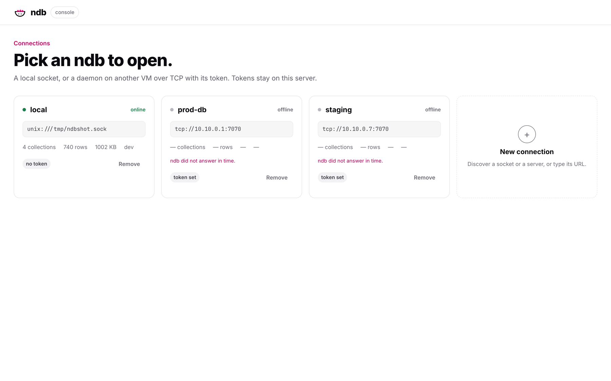
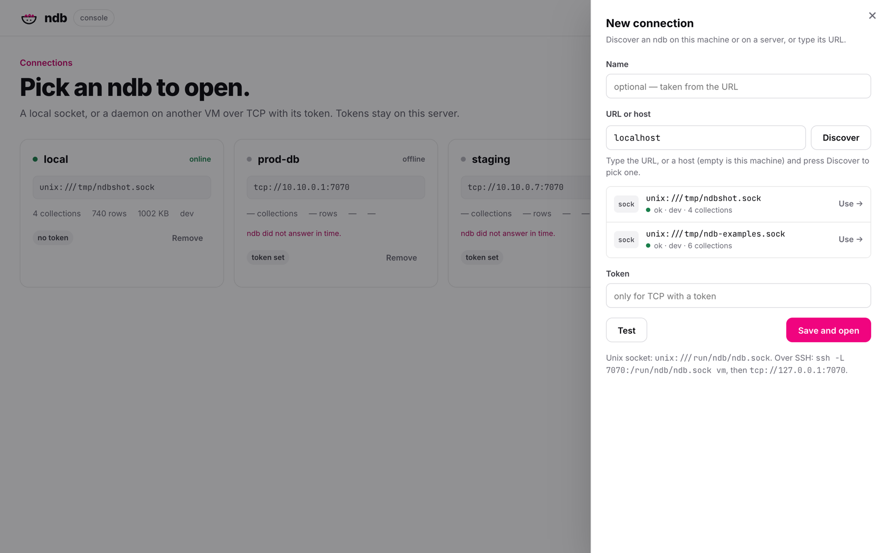
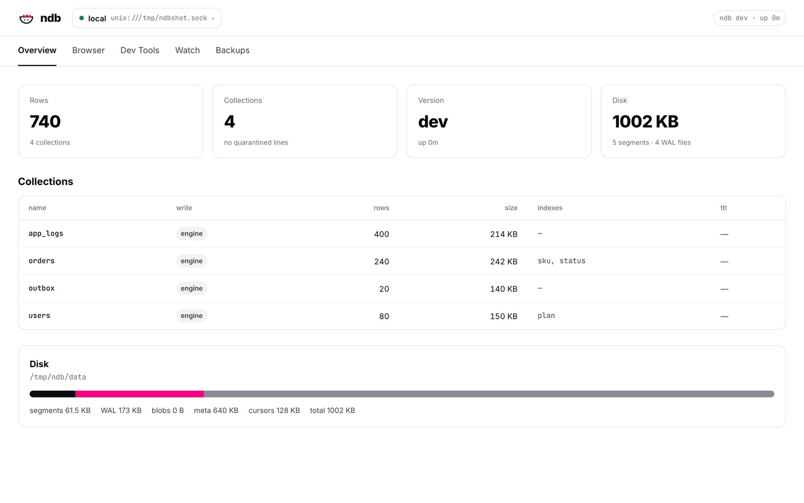
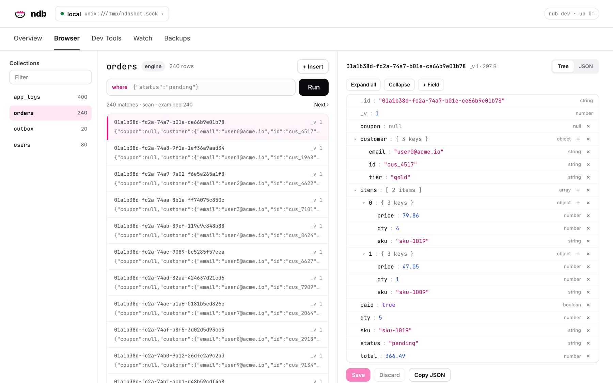
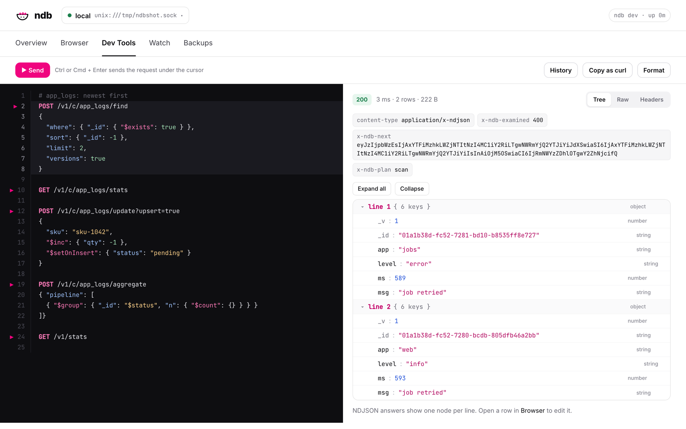
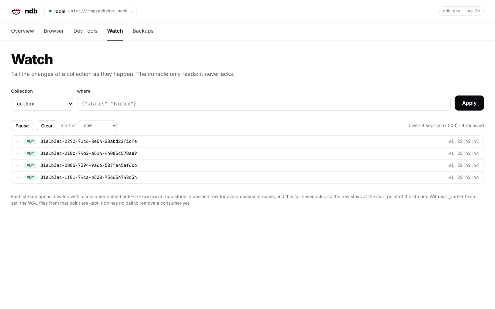
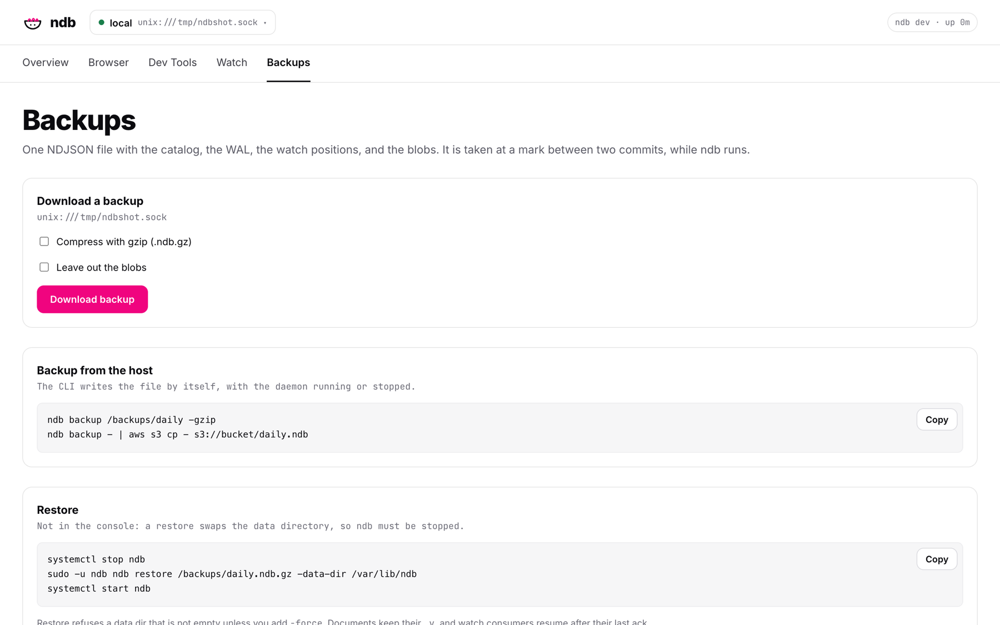

# UI guide

One page per screen of the console. Each tab works on the connection in the header; click the connection name to go back to the list.

## Connections

Each card shows if the daemon answers, its collections, rows, size and version. Click a card to open it. **Remove** forgets a connection (the daemon is not touched).

### New connection and Discover

The **+ New connection** card opens a drawer with three fields:

- **Name**, optional. Empty takes `local` for a socket, or the host for TCP.
- **URL or host.** Type the full URL, or a host and press **Discover**. Click a result to fill the URL.
- **Token**, only for TCP with a token. If a result needs one, the cursor moves there.

**Test** checks the connection, **Save and open** keeps it.

What Discover searches:

- **Empty, `localhost`, `127.0.0.1`, or `::1`:** unix sockets: `listen.unix` of `ndb.yml` (`NDB_CONFIG`, `./ndb.yml`, `/etc/ndb/ndb.yml`), `/run/ndb/ndb.sock`, and each `*.sock` in `/run/ndb`, `/var/run`, `/run`, `/tmp`, `$XDG_RUNTIME_DIR`, and the subfolders of `/tmp` with `ndb` in the name (at most 50). It also tries TCP on `127.0.0.1`.
- **Another host:** TCP on the port in the field (`10.10.0.1:7071`), or on `7070`.
- Each candidate gets `GET /health` with an 800 ms timeout. `ok` shows the version and the collection count, `needs a token` is a `401`, `starting` is a `503` while ndb recovers. Anything else is dropped. The probe never sends a saved token.

## Overview

Rows, collections, version and uptime, and disk. The table lists each collection with its write mode (`engine` or `direct`), rows, size, indexes and TTL. The disk bar splits segments, WAL, blobs, meta and cursors.

## Browser

- Pick a collection on the left, filter with `where` (JSON, the same as [find](../query.md#filters)), and page with **Next**. The line under the filter shows the plan and the rows examined.
- The selected document opens as a **tree**: click a value to edit it, **+ Field** adds one, **×** removes one. **JSON** shows the raw text, which you can edit too.
- **Save** sends only the changed fields as `$set` and `$unset`, with the `_v` that the page was loaded with as a guard. If somebody else wrote first, nothing is written and the page says so.
- **+ Insert** adds a document; **Delete** asks first. A `direct` collection is read-only.
- The collection, the filter, the page and the selected `_id` are in the URL, so a link shows the same view.

## Dev Tools

- Write requests as `METHOD /path` with an optional JSON body under it. **▶** marks each request; **Cmd/Ctrl + Enter** sends the one under the cursor.
- The editor indents for you: Enter keeps the indent and opens `{ }` blocks, `}` dedents, Tab and Shift+Tab move lines. The `{ }` button on hover formats the JSON body.
- The answer shows the status, time, size, the `X-Ndb-*` headers, and the body as **Tree**, **Raw** or **Headers**. An NDJSON answer shows one node per line.
- **History** keeps the last 50 requests, and the editor text is kept per connection in the browser. **Copy as curl** writes `$NDB_TOKEN` as a placeholder, never the token.
- Only paths that start with `/v1/`, plus `/health` and `/metrics`, are sent. `/v1/backup` and `watch` have their own tabs.

## Watch

Pick a collection, optionally a `where` filter, and **Start**: each change arrives as a `put` or `del` row; click one to see the document. **Pause**, **Clear**, and **Start at** (now or the beginning) control the stream. The list keeps the last 500 events.

The tail only reads: it never acks. Each stream opens a watch with a consumer named `ndb-ui-xxxxxxxx`, and ndb stores a position row for it in `cursors.bolt`. With `wal_retention`, the WAL files from the oldest such position are kept. ndb has no call to remove a consumer yet.

## Backups

**Download backup** streams `POST /v1/backup` to a file `ndb-<name>-<date>.ndb`, or `.ndb.gz` with gzip. It works on a unix socket connection only (ndb answers `403` over TCP; run `ndb backup` on the host). Restore is not in the console, because it replaces the data directory while ndb is stopped: copy the command from the page. See [Backup and restore](../operations.md#backup-and-restore).
