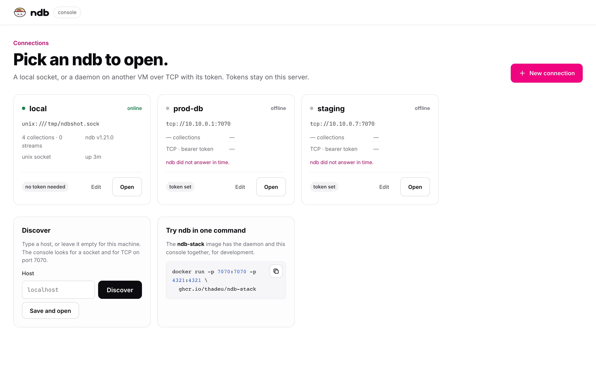
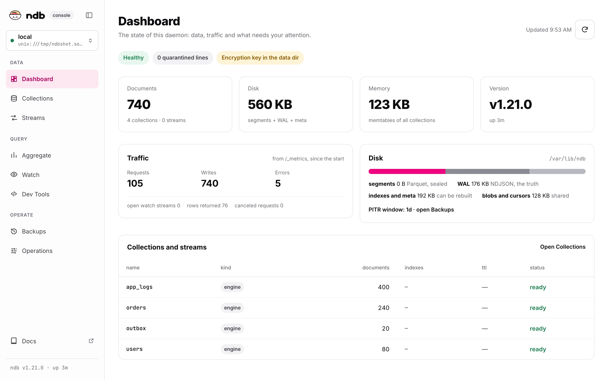
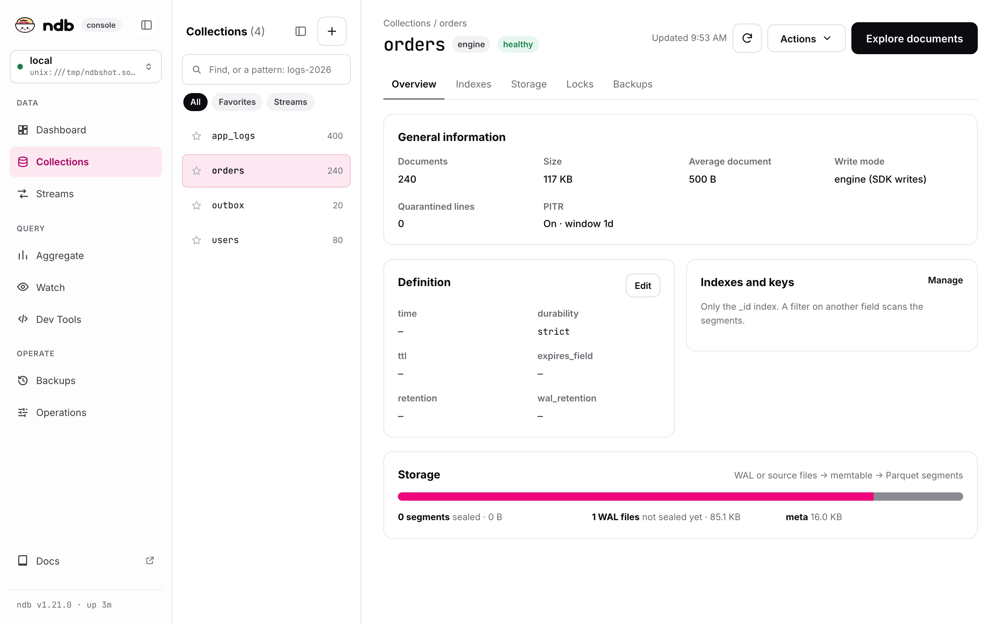
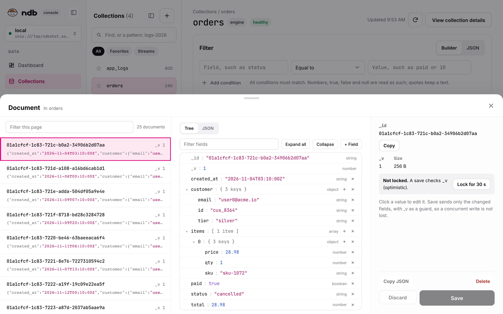
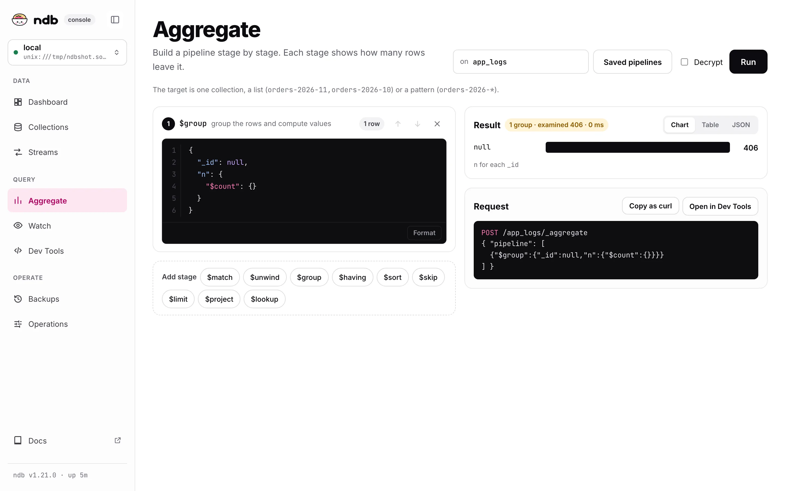
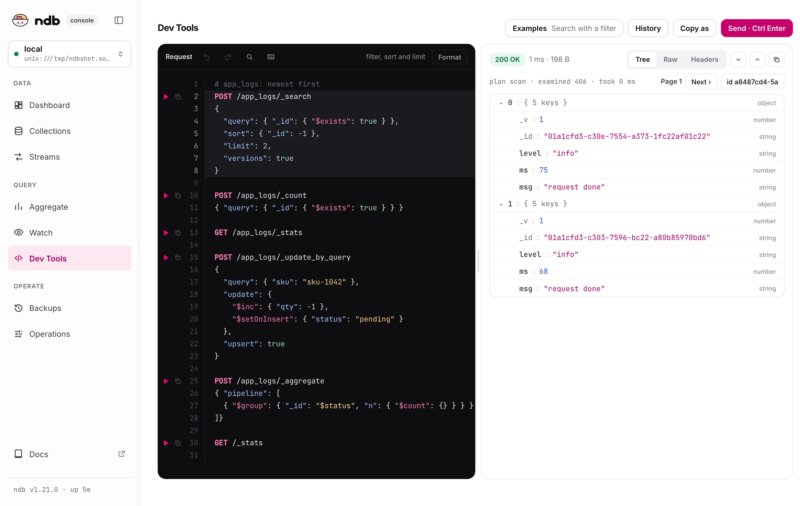
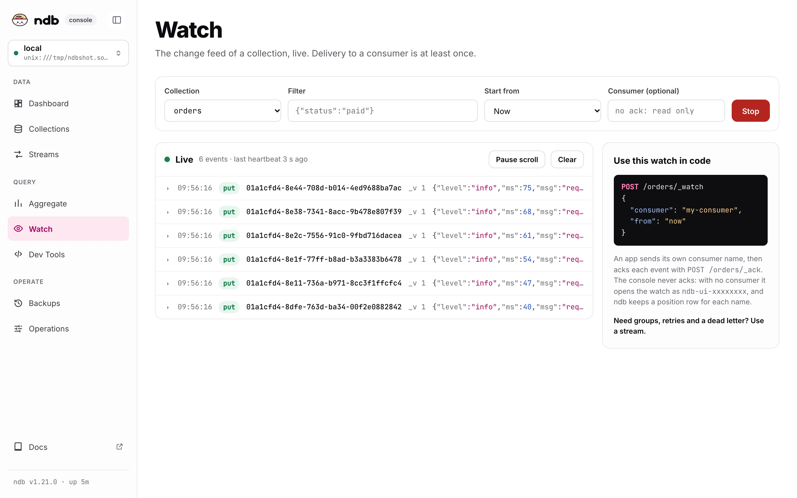
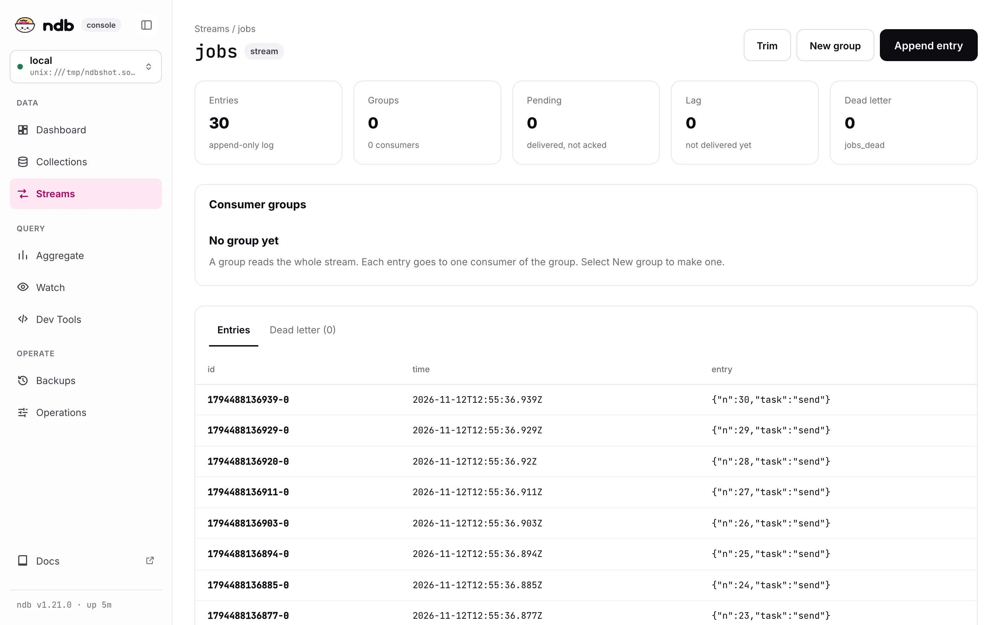
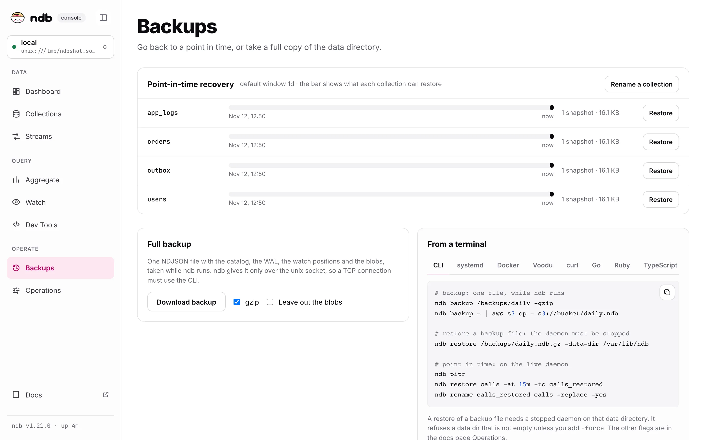
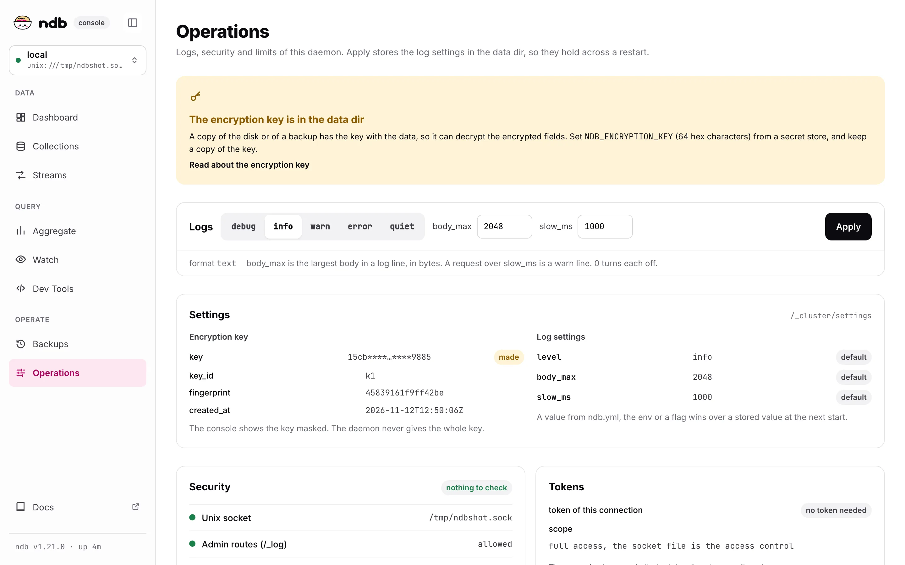

# UI guide

One page per screen of the console. Each screen works on the connection at the top of the side menu; click it to pick another one. Click a screenshot to see it at full size.

## Connections

Each card shows if the daemon answers, its collections, version and uptime. **Open** opens it, **Edit** changes it. The **Discover** card finds a daemon on this machine or on a host.

### New connection and Discover

**+ New connection** opens a drawer with three fields:

- **Name**, optional. Empty takes `local` for a socket, or the host for TCP.
- **URL or host.** Type the full URL, or a host and press **Discover**. Click a result to fill the URL.
- **Token**, only for TCP with a token. If a result needs one, the cursor moves there.

**Test** checks the connection, **Save and open** keeps it.

What Discover searches:

- **Empty, `localhost`, `127.0.0.1`, or `::1`:** unix sockets: `listen.unix` of `ndb.yml` (`NDB_CONFIG`, `./ndb.yml`, `/etc/ndb/ndb.yml`), `/run/ndb/ndb.sock`, and each `*.sock` in `/run/ndb`, `/var/run`, `/run`, `/tmp`, `$XDG_RUNTIME_DIR`, and the subfolders of `/tmp` with `ndb` in the name (at most 50). It also tries TCP on `127.0.0.1`.
- **Another host:** TCP on the port in the field (`10.10.0.1:7071`), or on `7070`.
- Each candidate gets `GET /health` with an 800 ms timeout. `ok` shows the version and the collection count, `needs a token` is a `401`, `starting` is a `503` while ndb recovers. Anything else is dropped. The probe never sends a saved token.

## Dashboard

The state of the daemon: health, quarantined lines, and the notes that need attention (for example, the encryption key in the data dir). The cards show documents, disk, memory and version. **Traffic** comes from `/_metrics`. The disk bar splits segments, WAL, indexes and meta, and blobs and cursors. The table lists each collection and stream with its kind, documents, indexes, TTL and status.

## Collections

Find a collection by name or by a pattern (`logs-2026-*`), and mark favorites with the star. **+** makes a collection. A collection has the tabs **Overview**, **Indexes**, **Storage**, **Locks** and **Backups**. **Actions** has the changes to the collection, and **Explore documents** opens the browser.

## Browser

- Open a collection and select **Explore documents**, filter with a query (JSON, the same as a [search](../query.md#filters)), and page with **Next**. The line under the filter shows the plan and the rows examined.
- The selected document opens as a **tree**: click a value to edit it, **+ Field** adds one, **×** removes one. **JSON** shows the raw text, which you can edit too.
- **Save** sends only the changed fields as `$set` and `$unset`, with the `_v` that the page was loaded with as a guard. If somebody else wrote first, nothing is written and the page says so.
- **+ Insert** adds a document; **Delete** asks first. A `direct` collection is read-only.
- The collection, the filter, the page and the selected `_id` are in the URL, so a link shows the same view.

## Aggregate

Build a [pipeline](../aggregate.md) stage by stage on one collection, a list, or a pattern. Each stage shows how many rows leave it. The result shows as **Chart**, **Table** or **JSON**. **Saved pipelines** keeps a pipeline, **Copy as curl** and **Open in Dev Tools** give the request.

## Dev Tools

- Write requests as `METHOD /path` with an optional JSON body under it. **▶** marks each request; **Cmd/Ctrl + Enter** sends the one under the cursor.
- The editor indents for you: Enter keeps the indent and opens `{ }` blocks, `}` dedents, Tab and Shift+Tab move lines. The `{ }` button on hover formats the JSON body.
- The answer shows the status, time, size, the `X-Ndb-*` headers, and the body as **Tree**, **Raw** or **Headers**. An NDJSON answer shows one node per line.
- **History** keeps the last 50 requests, and the editor text is kept per connection in the browser. **Copy as curl** writes `$NDB_TOKEN` as a placeholder, never the token.
- Every route of the [HTTP API](../http.md) can be sent, except `/_backup` and `_watch`, which have their own tabs.

## Watch

Pick a collection, optionally a query filter, and **Start**: each change arrives as a `put` or `del` row; click one to see the document. **Pause**, **Clear**, and **Start at** (now or the beginning) control the stream. The list keeps the last 500 events.

The tail only reads: it never acks. Each stream opens a watch with a consumer named `ndb-ui-xxxxxxxx`, and ndb stores a position row for it in `cursors.bolt`. With `wal_retention`, the WAL files from the oldest such position are kept. ndb has no call to remove a consumer yet.

## Streams

A [stream](../streams.md) shows its entries, groups, pending entries, lag and dead letter. **Append entry**, **New group** and **Trim** change it. The tabs show the entries and the dead letter; a group shows its pending entries.

## Backups

**Point-in-time recovery** shows the window that each collection can restore, with **Restore** and **Rename a collection**.

**Download backup** streams `POST /_backup` to a file `ndb-<name>-<date>.ndb`, or `.ndb.gz` with gzip. It works on a unix socket connection only (ndb answers `403` over TCP; run `ndb backup` on the host). Restore is not in the console, because it replaces the data directory while ndb is stopped: copy the command from the page. See [Backup and restore](../operations.md#backup-and-restore).

## Operations

The log level and the log limits (`body_max`, `slow_ms`): **Apply** stores them in the data dir, so they hold across a restart. The page also shows the encryption key (masked), the settings of `/_cluster/settings`, the security checks and the token of the connection.
